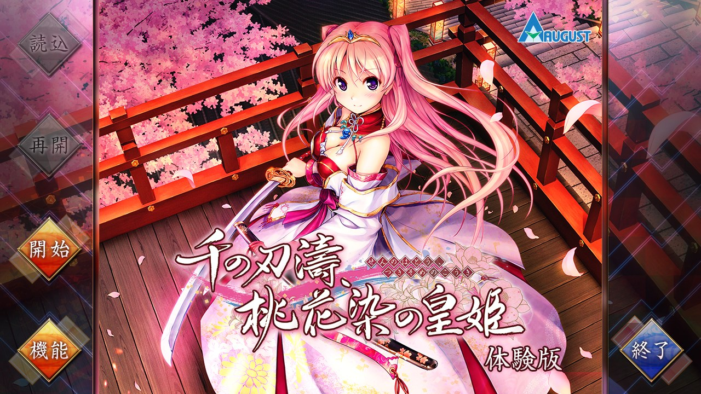
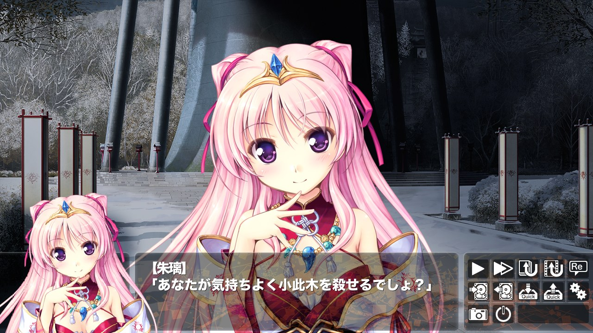

# ethornell-rs

`ethornell-rs` is a reimplementation of the Ethornell / BURIKO General Interpreter (a.k.a. "BGI") visual novel engine.

<table>
  <tr>
    <td width="50%" align="center">
      <br>
      <b>Desktop</b><br>
      <sub>千の刃濤、桃花染の皇姫 体験版 (BGI 1.622), title screen.</sub>
    </td>
    <td width="50%" align="center">
      <br>
      <b>Desktop</b><br>
      <sub>Character sprites, face window and message window.</sub>
    </td>
  </tr>
  <tr>
    <td width="50%" align="center">
      <br>
      <b>Web</b><br>
      <sub>The same game in Chrome (WebAssembly, WebGL2).</sub>
    </td>
    <td width="50%"></td>
  </tr>
</table>

The runtime detects the native game identifier from the comparison in
`system.arc:ipl._bp`. If detection is unavailable, the identifier falls back to
`Tayutama2TV`. For example:

```sh
cargo run -p ethornell-cli -- run --game /path/to/sun_flower
```

`--game` locates the resource archives, loose files, and user data.

Without arguments (a double-click), `ethornell` asks for the game folder;
`ethornell /path/to/sun_flower` plays it directly.

Builds for Windows (x86_64), Linux (x86_64 and AArch64), FreeBSD (x86_64),
macOS (a universal `Ethornell.app`), Android (APK), iOS (unsigned IPA), the
web (a static page), Nintendo Switch (NRO) and PS Vita (VPK) are published on
[GitHub Releases](https://github.com/xmoezzz/ethornell-rs/releases).
The `pre-release` entry follows `main`; `v*` tags publish versioned releases.
See [`platform/`](platform/README.md) for building and using each platform,
including the Android and iOS apps and the console ports.

The window uses the game's icon from `icon.png`, an `.ico` file, or the icon
resources embedded in its Windows executable, in that order.

Desktop and headless runs automatically detect Shift-JIS or GBK from a bounded
sample of scenario text. If the sample is insufficient, they use Shift-JIS.
Set `ETHORNELL_TEXT_ENCODING=gbk` or `ETHORNELL_TEXT_ENCODING=cp932` to override
detection. `ETHORNELL_TEXT_ENCODING=auto` enables detection explicitly.
This setting selects the encoding of text buffers passed to the graphics API,
including dialogue and speaker names. Resource names and BP system strings
keep their original encoding. Embedded hosts retain their explicit encoding
configuration.
